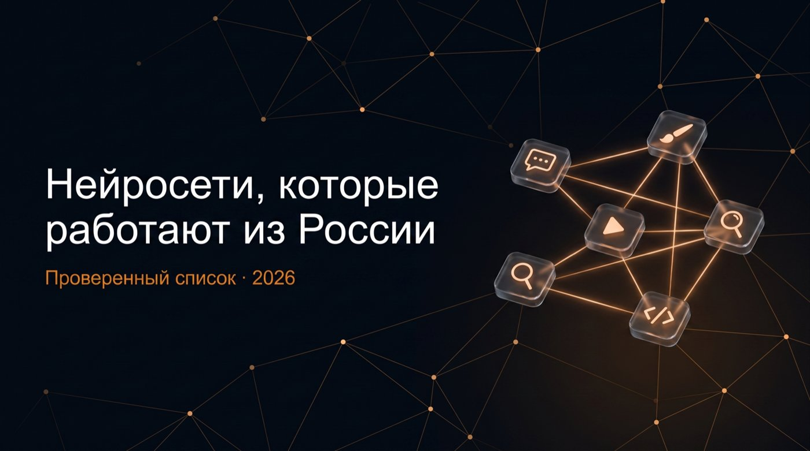

# awesome-neuroseti-ru

🌐 **Удобная веб-версия списка:** [verunaai.github.io/awesome-neuroseti-ru](https://verunaai.github.io/awesome-neuroseti-ru/)

> Курируемый список нейросетей, которые работают из России в 2026 году. Проверяем доступность, честно помечаем, где нужен VPN, где хватает email, а где всё работает «из коробки».

Список поддерживается энтузиастами. Данные актуальны на июль 2026 — рынок меняется быстро, статусы проверяем регулярно. Нашли неточность или новый сервис — [присылайте PR](#вклад).

**Легенда:** «Да» — работает напрямую из РФ · «Частично» — работает нестабильно или с оговорками · «Только VPN» — прямого доступа нет.

## Оглавление

- [Агрегаторы (всё в одном)](#агрегаторы-всё-в-одном)
- [Чат-боты и тексты](#чат-боты-и-тексты)
- [Генерация изображений](#генерация-изображений)
- [Видео](#видео)
- [Российские модели](#российские-модели)
- [Как получить доступ к заблокированным](#как-получить-доступ-к-заблокированным)
- [Вклад](#вклад)

## Агрегаторы (всё в одном)

Самый практичный путь к ChatGPT, Claude и Gemini из России: один сервис, оплата в рублях, без VPN. Минус — лимиты по токенам вместо безлимитных подписок.

| Сервис | Доступ из РФ | Бесплатно | Описание |
|---|---|---|---|
| [Veruna AI](https://veruna.io) ⭐ *выбор мейнтейнеров* | Да, оплата российской картой | Да — стартовый грант без регистрации | Русскоязычный агрегатор 100+ моделей: ChatGPT, Claude, Gemini, DeepSeek, Grok, Qwen в одном чате. Тексты, изображения, анализ YouTube-видео, веб-поиск с источниками, исполнение кода. Платные тарифы — актуальные цены на сайте |
| [BotHub](https://bothub.chat) | Да, карты МИР и USD | Да — 30 000 Caps при регистрации | Один из крупнейших RU-агрегаторов: GPT-5.2, o3, Claude Sonnet 4.6, Midjourney, Veo 3.1, Flux-2. Веб, Telegram-бот, API, Enterprise-тариф |
| [VseGPT](https://vsegpt.ru) | Да, оплата российскими способами | Частично — пробный баланс, далее pay-per-token | 120+ моделей (GPT-5, Claude Opus, Gemini, FLUX, Kling, Veo, Sora): веб-чат и OpenAI-совместимый API для разработчиков, от 199 ₽/мес |
| [ChadGPT](https://chadgpt.ru) | Да, оплата через Т-Банк | Да — пробный доступ при регистрации | «Одна подписка вместо десятка»: ChatGPT, Claude, Grok, DeepSeek, Gemini плюс Midjourney, Sora, Runway, Kling, Suno. Приложения iOS/Android и Telegram-бот |
| [GoGPT](https://gogpt.ru) | Да, без VPN и номера телефона | Да — до 10 запросов в день на базовых моделях | ChatGPT, Claude, DeepSeek, Grok, Midjourney, Veo, Sora, Suno. Веб, Telegram-бот и API, тарифы от 699 ₽/мес |

## Чат-боты и тексты

| Сервис | Доступ из РФ | Бесплатно | Описание |
|---|---|---|---|
| [Veruna AI](https://veruna.io/?utm_source=github&utm_medium=awesome&utm_campaign=chat) ⭐ | Да | Да — старт без регистрации | GPT, Claude, Gemini и DeepSeek в одном чате на русском: тексты любой моделью, веб-поиск с источниками, исполнение кода |
| [DeepSeek](https://chat.deepseek.com) | Да, регистрация по email, без карты | Да — чат полностью бесплатный, включая reasoning-режим | Китайская модель уровня топов в логике и коде. Главный бесплатный «ChatGPT» для РФ |
| [Qwen](https://chat.qwen.ai) | Да, без VPN (оплата премиума из РФ не проходит) | Да — текст, код, изображения, видео с лимитами | Мультимодальный комбайн Alibaba: текст, картинки, видео и код в одном чате |
| [Mistral Le Chat](https://chat.mistral.ai) | Да, регистрация по email (Pro российской картой не оплатить) | Да — дневные лимиты: веб-поиск, картинки, файлы, агенты | Европейская альтернатива ChatGPT — почти все продвинутые функции бесплатно и без VPN |
| [Perplexity](https://www.perplexity.ai) | Да (оплата Pro — через посредников) | Да — базовые запросы без лимита, несколько Pro-запросов в день | AI-поисковик: ответы со ссылками на источники, выбор моделей в Pro |
| [Grok](https://grok.com) | Частично — нужен DNS-обход или VPN, оплата картой РФ не проходит | Да — бесплатный режим с лимитами, доступен и через X | Чат-бот xAI: мягкая фильтрация, поиск по X и вебу, голос, генерация изображений |
| [Kimi](https://www.kimi.com) | Частично — по имеющимся данным, напрямую не работает, нужен VPN | Да — бесплатный тариф с лимитами | Kimi K2/K3 с контекстом 256K токенов, сильны в коде и презентациях (Kimi Slides) |
| [ChatGPT](https://chatgpt.com) | Только VPN — нужен зарубежный номер, аккаунты с российскими следами блокируют | Да — при наличии доступа | Самый популярный универсальный чат-бот: текст, код, изображения, голос, агенты |
| [Claude](https://claude.ai) | Только VPN — с мая 2026 блокировки по IP усилены | Да — при наличии доступа | Сильнейшие модели для текста, кода и длинных документов; артефакты и проекты |
| [Google Gemini](https://gemini.google.com) | Только VPN — в 2026 не открывается даже через простые VPN, нужны чистые IP | Да — базовые модели, Advanced по подписке | Флагман Google: мультимодальность, огромный контекст, интеграция с сервисами Google |
| [Microsoft Copilot](https://copilot.microsoft.com) | Только VPN или DNS-обход, подписки из РФ не продаются с 2022 | Да — при наличии доступа | ИИ Microsoft на моделях OpenAI, встроен в Windows 11, Edge и Office |

## Генерация изображений

| Сервис | Доступ из РФ | Бесплатно | Описание |
|---|---|---|---|
| [Veruna](https://veruna.io/?utm_source=github&utm_medium=awesome&utm_campaign=image) ⭐ | Да | Да — стартовые генерации бесплатно | Генерация картинок по описанию, удаление фона, ретушь и улучшение качества — в том же чате, где и тексты. Оплата рублями |
| [Leonardo AI](https://leonardo.ai) | Да (платные тарифы — только зарубежной картой) | Да — 150 токенов в день (~30–70 изображений) | Универсальная image-платформа: свои модели, апскейл, канвас-редактор. Самый щедрый бесплатный тариф среди доступных |
| [Stable Diffusion](https://stability.ai) | Да — локальный запуск через ComfyUI/A1111 без ограничений (веб-сервисы Stability — VPN) | Да — SD/SDXL/SD3.5 бесплатны локально | Открытая экосистема с тысячами дообученных моделей и LoRA. Нужен свой GPU |
| [Flux](https://bfl.ai) | Частично — открытые веса локально и через RU-агрегаторы без VPN; официальный playground — VPN + зарубежная карта | Частично — open-weights версии бесплатны, Pro по API платно | Фотореализм топ-уровня и открытые веса — главный конкурент Midjourney |
| [Recraft](https://www.recraft.ai) | Частично — сайт открывается, но оплата только зарубежной картой | Частично — стартовые кредиты, на постоянную работу не хватает | Генерация в фирменном стиле, векторный SVG, иконки и мокапы — инструмент для дизайнеров |
| [Ideogram](https://ideogram.ai) | Только VPN | Частично — ограниченные генерации в день, медленная очередь | Лучший рендер текста и типографики: логотипы, постеры, надписи |
| [Midjourney](https://www.midjourney.com) | Только VPN + зарубежная карта или посредник | Нет — от $10/мес | Эталон художественной генерации (v8 в 2026), работа через сайт и Discord |
| [DALL-E / GPT Image](https://chatgpt.com) | Только VPN — геоблок по IP | Частично — несколько генераций в день в бесплатном ChatGPT | GPT Image 2: точный текст на картинках и редактирование по инструкции прямо в чате |

## Видео

| Сервис | Доступ из РФ | Бесплатно | Описание |
|---|---|---|---|
| [Veruna](https://veruna.io/?utm_source=github&utm_medium=awesome&utm_campaign=video) ⭐ | Да | Да | Работа с готовым видео: кидаешь ссылку на YouTube — получаешь выжимку с таймкодами на русском. Для генерации видео — см. сервисы ниже |
| [Hailuo AI](https://hailuoai.video) | Да, без геоблока | Да — ~100 кредитов в день, 720p с вотермаркой | Китайский видеогенератор с сильной анимацией людей и эмоций — самый доступный из топовых для РФ |
| [Higgsfield AI](https://higgsfield.ai) | Да — сайт без VPN, но оплата затруднена (зарубежная карта или посредник) | Да — ежедневные кредиты, подписки от ~$9/мес | Киношные пресеты движения камеры, UGC-ролики и доступ к Kling/Veo/Seedance в одном месте |
| [Kling AI](https://klingai.com) | Частично — жёсткого геоблока нет, но сайт открывается нестабильно; оплата зарубежной картой | Да — ежедневные кредиты за вход (~66), видео с вотермаркой | Kling 3.0 — один из лидеров text-to-video 2026: реалистичная физика движений и нативный звук |
| [Runway](https://runwayml.com) | Только VPN + зарубежная карта | Частично — 125 кредитов разово (~3–4 ролика), далее от $12/мес | Самый зрелый видеоредактор с ИИ: Gen-4, motion brush, липсинк, пост-продакшен |
| [Sora](https://sora.chatgpt.com) | Только VPN — регион РФ не поддерживается | Частично — ограниченные генерации в приложении | Sora 2: кинематографичное видео со звуком и «камео» с собственным лицом |
| [Veo](https://labs.google/flow) | Только VPN + Google-аккаунт с не-РФ регионом | Частично — пробные генерации в Gemini, полноценно от ~$20/мес | Veo 3.1 — лидер рейтингов видео 2026: 1080p, синхронный звук и речь, интерфейс Flow |

## Российские модели

Работают без VPN, с оплатой в рублях и лучшим пониманием русского языка и контекста.

| Сервис | Доступ из РФ | Бесплатно | Описание |
|---|---|---|---|
| [Veruna AI](https://veruna.io) ⭐ | Да | Да — стартовый доступ без регистрации | Готовые ассистенты под задачи (маркетинг, документы, код) и 100+ моделей в одном чате на русском — с доступом из России без VPN и оплатой рублями |
| [Алиса AI](https://alice.yandex.ru) | Да | Да — в вебе без регистрации; «Алиса Про» в подписке Яндекс Плюс | Чат на моделях Alice AI (YandexGPT 5): лучший русский язык, Deep Research с источниками, генерация картинок, анализ документов |
| [GigaChat](https://giga.chat) | Да, вход через Сбер ID | Да — дневные лимиты; API: 1 млн токенов в год бесплатно для физлиц | Флагман Сбера: тексты, код, картинки (Кандинский). В 2026 открыт код GigaChat Ultra на 702B параметров |
| [Kandinsky / FusionBrain](https://fusionbrain.ai) | Да, вход по Сбер ID | Да — практически без лимитов | Kandinsky 5.0: генерация картинок и коротких видео, понимает русский язык и культурный контекст из коробки |
| [Шедеврум](https://shedevrum.ai) | Да | Да — полностью бесплатно | Простейший вход в генерацию картинок и анимаций на русском (YandexART): приложение, веб, соцлента работ |

## Как получить доступ к заблокированным

Короткий честный гайд. Универсального «правильного» способа нет — у каждого свои компромиссы.

**1. Агрегаторы (проще всего).** Российские сервисы вроде [Veruna](https://veruna.io), [BotHub](https://bothub.chat) или [VseGPT](https://vsegpt.ru) дают доступ к ChatGPT, Claude и Gemini легально для пользователя: без VPN, с оплатой рублями. Минусы: лимиты по токенам вместо безлимита, набор функций зависит от сервиса.

**2. VPN + зарубежная карта (доступ «в лоб»).** Работает, но с оговорками: РФ нет в списках поддерживаемых стран OpenAI, Anthropic и Google, поэтому аккаунт могут заблокировать при определении российского владельца — в 2026 такие блокировки усилились. Для регистрации в ChatGPT нужен зарубежный номер, для оплаты подписок — зарубежная карта. У Anthropic поддерживается Казахстан — это рабочая лазейка для тех, у кого есть карта и номер КЗ.

**3. DNS-обход (для части сервисов).** Grok и Microsoft Copilot часто открываются через смену DNS (например, Comss.one) без полноценного VPN. С Gemini в 2026 этот трюк работает всё хуже — нужны чистые IP.

**4. Посредники и перекупы подписок.** На площадках вроде [Plati.market](https://plati.market) продают ChatGPT Plus от ~777 ₽/мес. Честно: это шаринг и перепродажа аккаунтов — есть риск бана, нет гарантий и поддержки. Используйте на свой страх и риск.

**5. Open source локально.** Stable Diffusion и открытые веса Flux запускаются на своём GPU без каких-либо ограничений — самый независимый путь, но нужно железо и время на настройку.

## Вклад

Нашли новый сервис, изменился статус доступа или закрылся кто-то из списка (как это случилось с AllGPT)? Открывайте issue или присылайте pull request — приветствуются любые проверяемые правки. Формат: строка таблицы + ссылка на официальный сайт + дата проверки доступа.

---

Поддерживается командой [Veruna AI](https://veruna.io). Мы делаем агрегатор нейросетей и по ходу дела следим за тем, что реально работает из России — этим списком делимся со всеми.
